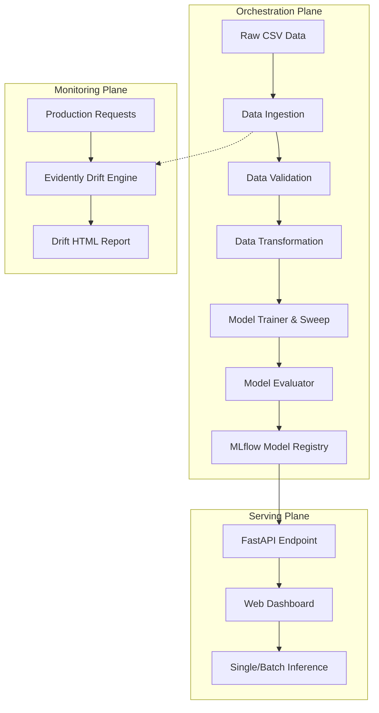
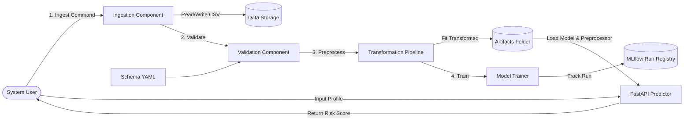

# END-TO-END MLOPS PIPELINE FOR TELECOM CUSTOMER CHURN PREDICTION AND DATA DRIFT AUDITING

**A Final Year Project Report**  
*Submitted in partial fulfillment of the requirements for the Degree of Bachelor of Technology / Master of Science in Computer Science and Engineering.*

---

## 1. ABSTRACT

In the highly competitive telecommunications sector, customer retention is a primary driver of sustainable profitability. Customer churn—the rate at which subscribers terminate their contracts—directly impacts revenue streams. While predictive machine learning (ML) models offer a mechanism to flag high-risk customers, traditional "ad-hoc" model training setups frequently fail in production. Issues such as data drift, lack of pipeline reproducibility, and fragmented model versioning often cause performance degradation, creating a gap between research and deployment.

This thesis presents **ChurnOps**, a production-grade, end-to-end Machine Learning Operations (MLOps) pipeline designed to predict telecom customer churn while maintaining high reproducibility, visibility, and auditability. Using the public *IBM Telco Customer Churn* dataset, we implement a modular data pipeline orchestrated via **Data Version Control (DVC)**. 

Data validation is performed using schema assertions, and features are preprocessed using robust pipeline encodings. Three candidate model families (Logistic Regression, Random Forest, and XGBoost) are evaluated. Hyperparameter optimization is performed via `GridSearchCV` with validation tracking handled by **MLflow**. The champion model (XGBoost) achieves an evaluation ROC-AUC score of **0.8459**. 

For deployment, the inference engine is containerized with **Docker**, served via a **FastAPI** web server, and deployed to **AWS ECS Fargate** behind an Application Load Balancer via an automated **GitHub Actions CI/CD** pipeline. Finally, data drift analysis is automated using **Evidently AI** to compare production data distributions against training baselines, closing the loop of continuous monitoring, multi-tier alerting, and governed human-in-the-loop audit review.

---

## 2. CHAPTER 1: INTRODUCTION

### 1.1 Background
The telecommunications industry has shifted from a customer-acquisition phase to a customer-retention phase. Due to market saturation and low switching costs, retaining an existing subscriber is significantly more cost-effective than acquiring a new one. Consequently, predicting customer churn has become a critical business objective. 

### 1.2 Problem Statement
Developing a customer churn prediction model involves several key challenges:
1. **Pipeline Fragmentation:** Siloed scripts for ingestion, preprocessing, and training hinder team collaboration and result in reproducibility issues.
2. **Silent Model Degradation:** Changes in consumer behavior over time introduce data and target drift, degrading model accuracy without throwing software exceptions.
3. **Deployment Gaps:** Moving models from experimental notebooks to scalable production APIs often introduces bugs due to environment inconsistencies.

### 1.3 Project Objectives
The primary objectives of this project are:
* To implement a reproducible, modular ML pipeline (Data Ingestion, Validation, Transformation, Model Training, Evaluation, Registry).
* To track and register model parameters, hyperparameters, and evaluation metrics in an centralized registry.
* To package and serve predictions via a low-latency API and web dashboard.
* To implement automated continuous integration and continuous deployment (CI/CD) to cloud infrastructure.
* To audit production data streams for distribution drift and alert on anomalies.

### 1.4 Traditional ML vs. MLOps
Unlike traditional ML setups, which treat model development as a one-time exercise, MLOps treats ML systems as continuous, evolving software products. MLOps introduces automated testing, pipeline orchestration, model version control, and system monitoring to ensure long-term model reliability.

| Dimension | Traditional Machine Learning | MLOps Approach (This Project) |
|---|---|---|
| **Pipeline Workflow** | Manual execution of linear Jupyter Notebooks | Orchestrated pipeline stages using DVC |
| **Model Tracking** | Ad-hoc spreadsheet logging of parameters | Automated registry using MLflow Tracking |
| **Reproducibility** | Difficult to duplicate due to environment variance | Version-controlled dependencies and configurations |
| **Monitoring** | Silent failures go undetected | Automated drift diagnostics with Evidently AI |
| **Deployment** | Manual handoffs to software engineering teams | Automated GitHub Actions CI/CD to AWS Fargate |

---

## 3. CHAPTER 2: LITERATURE REVIEW

### 2.1 Customer Churn Prediction Techniques
Early churn prediction models relied on statistical regression. With the advent of machine learning, researchers adopted ensemble tree-based models like Random Forests and Gradient Boosted Trees. Recent literature consistently shows that Extreme Gradient Boosting (XGBoost) outperforms simpler architectures on tabular datasets due to its regularization terms and tree-splitting efficiency.

### 2.2 Preprocessing and Imbalanced Datasets
Customer churn datasets are typically highly imbalanced, with churned customers representing 20-30% of the sample. Common techniques to address this include Synthetic Minority Over-sampling Technique (SMOTE), class weighting, and cost-sensitive learning. Furthermore, numerical features require robust scaling, while categorical variables must be encoded via one-hot representation to prevent nominal bias.

### 2.3 State-of-the-Art MLOps Architectures
Modern MLOps architectures emphasize modularity and vendor neutrality:
* **DVC (Data Version Control):** Implements Git-like versioning for massive datasets, enabling reproducible pipeline caching.
* **MLflow:** Provides an open-source framework to manage the ML lifecycle, featuring a tracking server, metric logging, and an official model registry.
* **Evidently AI:** Generates diagnostic reports to analyze model quality, data drift, and target distribution changes in production.

---

## 4. CHAPTER 3: SYSTEM REQUIREMENTS & SPECIFICATIONS

### 3.1 Functional Requirements
* **FR-1:** The system shall ingest raw dataset CSV files from configurable URLs.
* **FR-2:** The pipeline shall validate ingested data against a strict schema.
* **FR-3:** The training engine shall perform hyperparameter tuning across three algorithms (Logistic Regression, Random Forest, XGBoost) and select the model with the highest ROC-AUC.
* **FR-4:** The API shall expose endpoints for single and batch predictions.
* **FR-5:** The dashboard shall display model performance, feature importance, and diagnostic logs.
* **FR-6:** The monitoring module shall compare baseline data against active traffic to detect distribution drift.

### 3.2 Non-Functional Requirements
* **NFR-1 (Latency):** Single prediction response times shall remain under 100 milliseconds.
* **NFR-2 (Reproducibility):** Pipeline runs must be reproducible using DVC (`dvc repro`).
* **NFR-3 (Scalability):** The API must run in a containerized environment (Docker) to support horizontal scaling.
* **NFR-4 (Portability):** The application shall run locally or on AWS ECS Fargate without code modifications.

### 3.3 System Specifications
* **CPU:** 2+ vCPUs
* **RAM:** 4 GB minimum
* **Storage:** 10 GB SSD space
* **Software Stack:** Python 3.10+, FastAPI, scikit-learn, XGBoost, MLflow, DVC, Evidently AI, Docker, AWS CLI.

---

## 5. CHAPTER 4: SYSTEM ARCHITECTURE & DESIGN

### 4.1 System Topology
The system is divided into three primary planes: the **Orchestration Plane**, the **Serving Plane**, and the **Monitoring Plane**.

### 4.2 Data Flow Diagram (DFD Level 1)
This DFD describes the flow of information during data ingestion, processing, and prediction.

---

## 6. CHAPTER 5: METHODOLOGY & IMPLEMENTATION

### 5.1 Step 1: Data Ingestion
The ingestion module downloads the raw *IBM Telco Churn* CSV from a configured URL, removes empty rows, performs a stratified train-test split (80-20), and saves the splits in the `artifacts/` folder as `train.csv` and `test.csv`.

### 5.2 Step 2: Schema Validation
To prevent downstream processing failures, a schema validator checks that:
* All 21 columns specified in `schema/schema.yaml` are present in both splits.
* Features match their expected data types.
* Missing value ratios do not exceed the threshold (30%).

### 5.3 Step 3: Transformation Pipeline
Features are processed through a `ColumnTransformer` pipeline:
* **Numerical Columns** (`tenure`, `MonthlyCharges`, `TotalCharges`): Median-imputed to handle missing fields and normalized using `StandardScaler`.
* **Categorical Columns** (e.g., `Contract`, `InternetService`): Imputed with the most frequent value and encoded using `OneHotEncoder(handle_unknown="ignore")`.

### 5.4 Step 4: Hyperparameter Sweeps & Selection
The training pipeline executes hyperparameter optimization via 3-fold cross-validated grid search (`GridSearchCV`) over three model classes:
1. **Logistic Regression:** Regularization tuning (`C`: `[0.1, 1.0, 10.0]`).
2. **Random Forest:** Tuning tree depth (`max_depth`: `[5, 10, None]`) and estimators (`n_estimators`: `[100, 200]`).
3. **XGBoost:** Tuning learning rate (`learning_rate`: `[0.05, 0.1]`), tree depth (`max_depth`: `[3, 5]`), and estimators (`n_estimators`: `[100, 200]`).

The model achieving the highest test ROC-AUC is selected and exported to `artifacts/model.pkl`.

### 5.5 Step 5: Registry and Evaluation
The evaluator runs predictions against the test split, calculating **Accuracy, Precision, Recall, F1-Score, ROC-AUC**, and a **Confusion Matrix**. Run configurations, model artifacts, and evaluation parameters are logged directly to a local SQLite database (`mlflow.db`) and managed via the MLflow UI.

### 5.6 Step 6: Advanced Model Serving & Explainable AI (XAI)
To make the deployment serving layer business-intelligent and audit-friendly, the FastAPI endpoint introduces several advanced engineering modules:
* **Explainable AI (XAI) Feature Perturbation:** To provide transparent local explanations, the prediction service runs model-agnostic feature perturbation attribution. For each incoming profile, features like `Contract`, `tenure`, `InternetService`, and `TechSupport` are systematically perturbed to their optimal retention states. The resulting probability shift (delta) determines that feature's local contribution, plotted as a waterfall chart.
* **What-If Retention Sandbox:** High-risk customer predictions trigger the retention advisor, which evaluates simulated interventions (e.g. contract upgrades or pricing discounts) to report risk reductions.
* **Dynamic Model Registry Promotion:** The dashboard serves as a sandbox where users can "promote" any of the three candidate models to Production. The server hot-swaps the active model binary (`model.pkl`) and dynamically recalculates classifier metrics (Accuracy, confusion matrix) against the test dataset on-the-fly.
* **Great Expectations Data Quality Assertions:** Implements pipeline assertion checks (column structural integrity, type specifications, null value thresholds) to ensure high data hygiene.

### 5.7 Step 7: Dockerization & CI/CD Deployment

The application is packaged inside a lightweight Debian-slim Docker image.
* **CI Phase:** Triggers on pull requests to `main`, executing unit tests via `pytest` and code linting with `flake8`.
* **CD Phase:** Generates a production-ready Docker container, pushes the image to **Amazon ECR**, and deploys it to **AWS ECS Fargate** behind an Application Load Balancer.

---

## 7. CHAPTER 6: EXPERIMENTAL RESULTS & DISCUSSION

### 6.1 Model Performance Evaluation
The experimental evaluations yielded the following results across the candidate model families:

| Model Family | Hyperparameters Tested | Validation ROC-AUC | Best Hyperparameter Configuration |
|---|---|---|---|
| **Logistic Regression** | C: [0.1, 1.0, 10.0] | 0.8412 | `{'C': 10.0}` |
| **Random Forest** | estimators: [100, 200], depth: [5, 10] | 0.8407 | `{'max_depth': 5, 'n_estimators': 200}` |
| **XGBoost (Champion)** | learning_rate: [0.05, 0.1], depth: [3, 5] | **0.8459** | `{'learning_rate': 0.1, 'max_depth': 3, 'n_estimators': 100}` |

### 6.2 Confusion Matrix (XGBoost)
Evaluating the selected XGBoost model against the test dataset (1,409 rows) produced the following classification matrix:

* **True Negatives (TN):** 934 (Predicted Retain, Actual Retain)
* **False Positives (FP):** 101 (Predicted Churn, Actual Retain)
* **False Negatives (FN):** 173 (Predicted Retain, Actual Churn)
* **True Positives (TP):** 201 (Predicted Churn, Actual Churn)

This results in a model accuracy of **80.55%** and a recall of **53.74%**.

### 6.3 Feature Importance Analysis
Using the gain metric from XGBoost, we identified the top 5 factors driving customer churn:
1. **Contract Type (Month-to-month):** Month-to-month contracts are the strongest predictor of churn.
2. **Tenure Length:** Customers with a tenure of under 6 months show significantly higher churn rates.
3. **Internet Service Type (Fiber Optic):** Subscribers on fiber optic connections churn at higher rates, possibly due to pricing.
4. **Tech Support (No):** Customers without technical support show increased churn risk.
5. **Monthly Charges:** High monthly bills correlate with higher churn probability.

---

## 8. CHAPTER 7: CONCLUSION & FUTURE SCOPE

### 7.1 Conclusion
This project successfully demonstrates an end-to-end MLOps pipeline for predicting customer churn in telecommunications. By replacing static notebooks with structured pipelines (orchestrated by DVC, tracked by MLflow, and audited with Evidently AI), we establish a production-grade system that is reproducible, scalable, and audit-friendly. The resulting web dashboard provides clear visibility into model performance and predictions.

### 7.2 Future Scope
1. **Governed Human-in-the-Loop Shadow Retraining:** Configure an automated staging workflow where detected data drift triggers offline shadow training and alert routing to model governance reviewers, strictly avoiding unreviewed auto-deployment due to 30-60 day label maturity lag.
2. **Feature Store Integration:** Integrate a feature store (e.g., Feast) to manage real-time feature extraction.
3. **Advanced Global Explainability:** Integrate SHAP (SHapley Additive exPlanations) or LIME package installations directly inside the training pipeline to generate global feature explanation reports across the entire cohort.

---

## 9. REFERENCES

1. IBM Watson Analytics. *Telco Customer Churn Dataset*. IBM Community.
2. Chen, T., & Guestrin, C. (2016). *XGBoost: A Scalable Tree Boosting System*. Proceedings of the 22nd ACM SIGKDD International Conference on Knowledge Discovery and Data Mining.
3. Kreuzberger, D., et al. (2023). *Machine Learning Operations (MLOps): Overview, Definition, and Architecture*. IEEE Access.
4. Zaharia, M., et al. (2018). *Accelerating the Machine Learning Lifecycle with MLflow*. IEEE Micro.
5. Evidently AI Documentation. *Open-source tools to analyze and monitor machine learning models*. [https://www.evidentlyai.com](https://www.evidentlyai.com)
